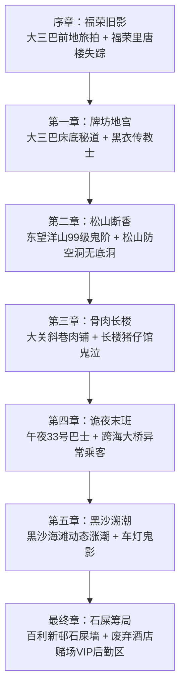

# 《澳诡实录》(Aomen Paranormal Records) — 游戏总策划案与 AI Agent 统一开发最高蓝图 (All-in-One Master Doc)

> **致 AI Agent 的最高执行指令（CRITICAL SYSTEM DIRECTIVE）**：  
> 本文件是《澳诡实录》项目的**唯一真理源（Single Source of Truth）**，集成了**完整游戏设计策划案（GDD）**、**实景原型视频抽帧还原规范**与 **Godot 4 底层代码架构铁律**。  
> 你在执行任何策划扩写、瓦片地图生成、GDScript 编写、场景搭建或 Bug 修复任务时，**必须 100% 服从本文件中的命名、参数、目录结构、碰撞层级与状态机接口，严禁私自篡改角色名称、新增多余全局变量或偏离 2D 像素俯视角规范**。

---

## 零、 制作人最终拍板锁定的全局固定参数（Locked Constants D1–D8）

| 编号 | 锁定维度 | 全局唯一执行标准（严禁 AI Agent 修改） |
| :--- | :--- | :--- |
| **D1** | **男主角（Player）** | **陈大文**（粤语昵称：**阿文 / 大文**），24岁，香港工程系毕业，务实理性、毒舌但极护短。初始背包自带关键工具道具 `multitool_pliers`（**多功能工具钳**，用于剪铁丝、拆通风口螺丝、撬电箱）。 |
| **D2** | **女主角（Missing GF）** | **黄嘉敏**（粤语昵称：**嘉敏 / 阿敏**），23岁，香港民俗专栏作者。独立敏锐、热爱摄影与历史考据，为查明外婆遗物中一张摄于[大三巴牌坊](https://www.macaotourism.gov.mo/zh-hans/sightseeing/macao-world-heritage/ruins-of-st-pauls)旁福荣里唐楼的旧照片秘密赴澳。失踪时遗留核心终端 `jiamin_phone`（**嘉敏的智能手机**）与《澳门怪谈手札》。 |
| **D3** | **游戏正式名称** | 中文名：**《澳诡实录》** ｜ 英文名：**Aomen Paranormal Records** |
| **D4** | **手电筒与移动控制** | **鼠标 360° 自由指向**：`W/A/S/D` 控制四方向平滑移动，**鼠标光标自由控制 60° 手电筒光锥朝向**（`PointLight2D` 照射距离 8 格 / `256px`，方便精细照墙找线索、看清防空洞地面垃圾与无底洞边缘）。 |
| **D5** | **游戏内 HUD 样式** | **轻量级《野比大雄的生化危机》风 HUD**：屏幕左上角仅显示简洁的**“冲刺体力条（Stamina）+ 手电电量格（Battery）”**；恐惧值不显示百分比数字，全部通过**动态心跳声加速 + 屏幕边缘暗角/色差抖动 Shader** 直观表现。 |
| **D6** | **手机闪光灯防身机制** | **有限防身（每章限 1~2 次）**：唤出手机相机按 `R` 键消耗 **25% 手机电量**释放强光闪光灯，不仅能拍摄灵异线索存证，还能在被贴脸追击时**致盲眩晕怪物 2.5 秒**（使怪物进入 `STUNNED` 状态）。 |
| **D7** | **章节切分与保底策略** | **7 章完整框架 + 三级保底开发**：序章（唐楼失踪）+ 第1章（大三巴秘道）+ 第2章（松山防空洞）+ 第3章（大关斜巷）+ 第4章（33号巴士）+ 第5章（黑沙海滩）+ 最终章（百利新邨石屎墙与废弃酒店赌场VIP后勤区）。 |
| **D8** | **松山防空洞实拍视频原型与 1:1 场景还原** | 第二章松山防空洞严格以实拍探险视频 **[《軒著霍哥去探險06：松山防空洞》](https://www.youtube.com/watch?v=_NzLM39sZXA)** 为原型，实装**“流浪汉床铺/易拉罐/黄色尿渍水洼噪音陷阱 + 中央坍塌垂直【无底洞】（跌落即死+可诱敌坠落）”**；全游戏所有场景必须基于真实历史照片或视频关键帧进行 1:1 像素还原。 |

---

## 一、 项目概述与雷火大赛拿奖策略

### 1.1 赛道转型与核心定位
- **告别 3D 泥潭，锁定 2D 俯视角像素黄金赛道**：针对 **2026年11月27日** 雷火游戏开发大赛最终作品提交截止日（剩余 18 天），全面采用对标《野比大雄的生化危机》《魔女之家》《尸体派对》的 **2D Top-down Pixel Art RPG（32×32 像素瓦片 + Godot 4 动态 2D 光影）** 架构。
- **评审得分权重精准拆解（40% 核心体验 + 20% 创新 + 20% 艺术表现 + 20% 技术实现）**：

| 评审维度（权重） | 往届获奖作品共性规律（参考《东方绮云谭》《逃离像素城》《了脱驿》） | 《澳诡实录》核心得分抓手 |
| :--- | :--- | :--- |
| **核心体验 (40%)** | 玩法优先于播片；操作手感干脆；前15分钟内必须完成“情绪代入→核心玩法闭环→高潮正反馈”，全流程零卡死。 | **1. 序章前5分钟“生动的爱意”**：先操作陈大文陪女友黄嘉敏在大三巴拍照、吃葡挞、斗嘴，再突发失踪，拉满拯救欲；<br>**2. 拒绝电子小说**：每段剧情信息必须转化为实际操作（对照旧照片找暗门、听录音辨方位、接电话触发断电追逐）。 |
| **玩法创新 (20%)** | 在经典品类上做“文化母题+微机制”融合。 | **1. 智能手机五合一终端 + 强光防身**：集拍立得闪光致盲（眩晕2.5秒）、分贝声波监测、微信跨时空语音、怪谈手札守则、地图于一体；<br>**2. 七章七套独立机制**：大三巴秘道视野闪现、松山99级楼梯禁回头与防空洞无底洞、大关斜巷十六两铜秤、33号巴士异常筛查、黑沙海滩动态涨潮、旧赌厅命筹天平。 |
| **艺术表现 (20%)** | 调色盘统一、光影后处理到位、方言配音地道。 | **1. 1:1 澳门实景原型转像素 + 动态光影**：基于实拍视频抽帧与历史照片还原场景，配合 `PointLight2D` 鼠标 360° 手电实时阴影；<br>**2. 五人团队 AI 粤语配音**：全粤语生活化台词 + 5轨动态心跳音轨闪避混音。 |
| **技术实现 (20%)** | 代码结构模块化、无运行时报错、有自动化测试支撑。 | **1. 后台统一架构铁律**：四大 Autoload 单例 + 数据驱动 JSON 配置；<br>**2. 内置 AutoBot 8维遥测挂机探针**：支持无头模式连续数小时自动跑图，自动生成卡关与死亡热力图。 |

---

## 二、 世界观法则與澳门本土素材考据库

### 2.1 世界观底层法则：现实澳门 + 民间怪谈 + 留白式超自然
1. **不设架空组织与超能力**：游戏发生在现代澳门，不设立统一的神秘学组织或“回声”超能力体系。
2. **多元恐怖源头与适度留白**：不同章节拥有独立的恐怖来源——有的是历史创伤与教会秘道执念，有的是空间规则异变，有的是人为罪案背后的心理阴影。不需要向玩家科学解释所有灵异现象，保持真假莫辨的民俗悬疑感。

### 2.2 权威历史与都市传说考据库（全章节创作基准）

| 传说/案件素材 | 涉及澳门真实地点 | 核心怪谈与真实历史背景（附权威考据来源） | 游戏改编定位与伦理边界 |
| :--- | :--- | :--- | :--- |
| **1. 大三巴秘道与黑衣传教士** | [大三巴牌坊](https://www.macaotourism.gov.mo/zh-hans/sightseeing/macao-world-heritage/ruins-of-st-pauls)、福荣里旧唐楼、[天主教艺术博物馆与墓室](https://www.macaotourism.gov.mo/zh-hans/sightseeing/museums-and-galleries/museum-of-sacred-art-and-crypt) | 传说大三巴地底有秘道通往大炮台，住户小孩常与“黑袍老伯”聊天，父亲在床底发现秘道，孩子看到黑袍老人，父亲看到的却是白骨。真实背景：[澳门记忆：大三巴的秘道传说](https://www.macaumemory.mo/specialtopic_1725b107678c477c85b32146a3b1f289?lgType=zh-mo)记载1961年牌坊后确实挖出数十具昔日教会墓地遗骨。 | 作为**序章与第一章**核心场景：将唐楼床底秘道与16世纪天主教花岗岩墓室结合，塑造“视野边缘闪现的黑衣传教士”。 |
| **2. 东望洋山烧香、九十九级楼梯与防空洞** | [东望洋山（松山）](https://www.culturalheritage.mo/detail/99945)、[1931松山军用隧道](https://www.macaotourism.gov.mo/zh-hans/events/whatson/2891/?month=10)、未开放荒废防空洞 | 传说新警员夜间需持点燃的香绕松山走一圈且严禁回头，回头见群鬼吓逃；另有数不清的“九十九级神秘楼梯”。实景参考探险视频 **[《軒著霍哥去探險06：松山防空洞》](https://www.youtube.com/watch?v=_NzLM39sZXA)**。 | 作为**第二章**核心玩法：还原防空洞内流浪汉垃圾、尿骚味水洼与中央坍塌垂直**无底洞**即死陷阱，结合“持香禁回头+99级台阶计数”空间循环。 |
| **3. 大关斜巷“食人巷”与长楼鬼泣** | [大关斜巷](https://www.historyedu.mo/?page_id=261)、[长楼斜巷](https://www.macaumemory.mo/entries_1d205b30c20e4ef7be180f8ded343b7e) | 二战太平洋战争爆发后香港沦陷、难民涌入澳门引发大饥荒（饿死逾1.7万人，黑箱车沿街收尸），盛传大关斜巷暗藏伏击肥胖妇孺的“猎人”（“肥人慎入大关斜巷”）；紧邻的长楼斜巷早年为关押契约华工的“猪仔馆”，传闻大火烧死铁笼苦力后深夜常传凄厉哭声。 | 作为**第三章**核心场景：主打心理恐怖与历史档案交叉推理（照片4人 vs 登记簿3人 vs 录音第4人声音），不直接展现血腥屠宰画面。 |
| **4. 末班33号巴士与路氹女鬼** | [澳门巴士33路线](https://zh.wikipedia.org/zh-cn/%E6%BE%B3%E9%96%80%E5%B7%B4%E5%A3%AB33%E8%B7%AF%E7%B7%9A)、旧澳氹跨海大桥 | 传说2004-2005年前后深夜末班[新福利公共汽车](https://zh.wikipedia.org/zh-cn/%E6%BE%B3%E9%96%80%E6%96%B0%E7%A6%8F%E5%88%A9%E5%85%AC%E5%85%B1%E6%B1%BD%E8%BB%8A)33号巴士出现独自乘车的校服女学生，上车无声，到站回头座位空无一人；另有路氹公路夜车司机见白衣女子招手、停车后消失或出现在后座的传说。 | 作为**第四章**独立机制关卡：打造移动密室“异常乘客识别与车窗倒影找茬”玩法。 |
| **5. 黑沙海滩鬼影与1985八仙饭店案** | [路环黑沙海滩](https://www.macaotourism.gov.mo/zh-hans/shows-and-entertainment/sports-and-recreation/beaches-and-nautical-sports)、黑沙环旧址 | 深夜驾车经黑沙海滩常见白衣人影被车灯照后消失。同时黑沙海滩也是[1985年八仙饭店灭门案](https://zh.wikipedia.org/zh-cn/%E5%85%AB%E4%BB%99%E9%A3%AF%E5%BA%97%E6%BB%85%E9%96%80%E6%A1%88)首次发现残肢之地（2019年澳门《正报》访谈已证实所谓“人肉叉烧包”系当年记者虚构）。 | 作为**第五章**环境生存关卡：加入“潮汐涨落改变地形+沙滩脚印追踪”；在档案剪报中**明确澄清叉烧包系记者虚构**，严守纪实伦理。 |
| **6. 2011百利新邨“石屎藏尸”案** | 黑沙环百利新邨电单车行、旧娱乐场贵宾厅 | [2011年百利新邨碎尸案](https://zh.wikipedia.org/zh-cn/%E6%BE%B3%E9%96%80%E5%91%BD%E6%A1%88%E5%88%97%E8%A1%A8)：业主收回电单车行清理时发现店后凭空多出一堵三层一尺厚水泥墙（石屎墙），凿开后藏有5袋被肢解且缺失头颅与右掌的赌场江湖叔父腐尸。 | 作为**最终章**核心舞台：以黑沙环电单车行“新建渗血石屎墙”连通隔壁废弃酒店及地下赌场VIP后勤区，**严禁任何赌博玩法**。 |

---

## 三、 全七章关卡蓝图与深度谜题设计（序章 + 五大章节 + 最终章）



### 3.1 序章：福荣旧影（地点：大三巴前地 → 福荣里旧式唐楼）
- **预计时长**：15~20 分钟（情感锚定 + 基础教学 + 第一次动态恐怖追逐）
- **关卡流程与核心机制**：
  1. **前 5 分钟“生动的爱意”（拒绝工具人女友）**：
     - 傍晚微雨的大三巴牌坊与恋爱巷，玩家操作**陈大文**移动鼠标取景框帮摆姿势的女友**黄嘉敏**拍下一张黄昏拍立得合影；
     - 嘉敏递给大文一个热腾腾的葡挞（恢复满体力），笑骂他拍照直男，并在长椅上摊开她手绘的《澳门探秘手札》。
  2. **踏入福荣里唐楼（5~10分钟）**：
     - 两人进入大三巴旁一栋待拆迁的四层旧式唐楼（绿白马赛克花砖、墨绿铁趟栊门、滴水天井）。嘉敏上三楼 304 室敲门采访，陈大文使用初始道具 **多功能工具钳（`multitool_pliers`）** 去一楼电表房拧开生锈铁盒合闸。
  3. **离奇失踪与动态电话事件（10~15分钟）**：
     - 合闸返回三楼时，嘉敏离奇失踪，地上只剩刚拍好的拍立得（照片背景窗户多出一个黑影）和她的智能手机（按 `Q/Tab` 拾取解锁手机五合一系统）。
     - 此时屋内断线的旧转盘电话突然炸响，接听后传来嘉敏颤抖的粤语：「大文……唔好出声……佢喺床下面看着我……」但声音却来自玩家身后的卧室！
     - 话音刚落，全屋断电（`CanvasModulate` 切换极暗）、走廊房门自动反锁，玩家必须开启手电筒（`F`键，鼠标 360° 指向），第一次钻入木衣柜按住 `Space` 触发心跳屏息 QTE 躲避黑影，随后在儿童房推开铁架床，发现床底通往地底的秘道入口。

### 3.2 第一章：牌坊地宫（地点：大三巴地下秘道与天主教墓室遗址）
- **预计时长**：20~25 分钟
- **核心玩法：地下探索 + 1961挖掘平面图比对 + 黑衣传教士视线恐怖**
  1. **核心谜题（平面图与小孩涂鸦比对）**：在唐楼夹层与地下砖石水道中，收集住户小孩画的蜡笔涂鸦（画着“穿黑袍的胡子老伯伯”）与 1961 年市政挖掘平面图。比对发现平面图东侧多出一间被封死的隐藏告解室，对照历史照片推开错位石砖进入原圣保禄学院地底花岗岩墓穴。
  2. **黑衣传教士 AI 机制**：
     - 平时在远处走廊尽头或手电筒光锥边缘一闪而过；
     - 在花岗岩遗骨壁龛区，当手电筒未照向他时，他会伴随拉丁文低语向陈大文逼近；当鼠标手电光锥直照他时，显出披着黑袍的白骨真身并短暂驻足（若被逼入死角，可按 `R` 释放手机强光闪光灯眩晕 2.5 秒逃生）。
  3. **主线推进**：在祭坛拾取嘉敏留下的字条与松山防空洞旧地图，用工具钳剪开排水涵洞铁网进入东望洋山麓。

### 3.3 第二章：松山断香（地点：东望洋山九十九级楼梯 + 松山防空洞）
- **预计时长**：20~25 分钟
- **核心玩法：持香禁回头规则 + 九十九级楼梯空间循环 + 防空洞实景探索与无底洞地形杀**
  1. **上半场：九十九级楼梯之咒（空间循环与听觉诱导）**：
     - 山道石碑刻着旧警训：**“九十九级定乾坤，一百步入枉死门；步步燃香莫反顾，逢双踏左单踏右。”**
     - 陈大文在山脚神龛点燃一支“引路香”向北攀登。途中身后不断传来密集脚步声与伪装成黄嘉敏的粤语呼救（「大文！救我啊！喺你后面！」）。
     - **破局规则**：攀登期间严禁将鼠标手电筒光锥转回正南（身后）或按 `S` 转身，否则直接触发群鬼贴脸杀；必须根据墙面粉笔刻痕数到第 99 级，面对凭空多出的腐朽“第 100 级”台阶时，**保持面朝前方按 S 后退一步**，即可破除循环进入松山防空洞入口。
  2. **下半场：基于《軒著霍哥去探險06：松山防空洞》实拍原型的内部还原与【无底洞】设计**：
     - **实拍视频原型锚点（参考 `https://www.youtube.com/watch?v=_NzLM39sZXA`）**：
       - **入口与狭长拱顶走道**：还原视频中半掩在山坡杂草与树根间的隐蔽防空洞水泥入口，内部仅容一至两人并行的狭长弧形水泥/石砌拱顶通道，墙皮剥落露出青灰色砖石，顶壁不断滴落冷水，墙根涂有斑驳的红色/白色旧编号与涂鸦；
       - **流浪汉遗留物与尿骚味环境细节**：还原荒废防空洞分支室内的肮脏阴冷感——潮湿地面散落着发霉的破床垫、塑料水瓶、碎玻璃、红白易拉罐、烧黑的蜡烛头以及泛黄发臭的**尿渍水洼**；
       - **噪音感知机制**：陈大文必须用鼠标 360° 手电筒照清脚下路线——一旦踩中**易拉罐、碎玻璃或尿渍水洼**，立即向 `EventBus` 发出半径 `160px` 的噪音信号，引来防空洞深处的“无脸巡山人”循声追捕；
       - **核心绝杀地形：中央坍塌【无底洞】**：在防空洞深处废弃发电机房/储油室中央，地面存在一个深不见底、黑漆漆的垂直通风竖井（**无底洞**），周围仅有几根锈断的铁链护栏。手电光照射下去一片虚无，陈大文一旦失足踩入边缘（`Layer 5: Hazard_Trigger`）将直接坠落惨死；在拿到嘉敏遗留的采访录音笔触发追逐战时，玩家可跑向无底洞对岸踢翻铁皮桶制造噪音，诱使失明的防空洞怪物直冲跌落无底洞！

### 3.4 第三章：骨肉长楼（地点：大关斜巷 + 长楼斜巷）
- **预计时长**：20~25 分钟
- **核心玩法：多源档案矛盾推理 + 十六两八卦秤机关 + 空间异变**
  1. **四口之家矛盾推理**：陈大文在陡峭的麻石斜巷与青砖旧肉铺中收集 4 份相互矛盾的资料：① 一张旧照片显示房间里有 **4名住户**；② 住户登记簿却只记录 **3个人**；③ 一封旧信提到某人早已失踪；④ 嘉敏留下的录音带中却清晰出现了**第4个人的声音**。玩家需整理时间线与矛盾点，推开肉铺冷柜找出隐藏密室。
  2. **十六两八卦秤谜题**：密室案板上放着一杆旧制铜杆秤（旧制一斤十六两，八两为半斤），将刻有【饥】【寒】【贪】【嗔】的四枚铜砝码按账本重量配平，打开通往长楼斜巷昔日“猪仔馆”铁笼地牢的暗门，拾取嘉敏掉落的“新福利 33 号巴士车票”。

### 3.5 第四章：诡夜末班（地点：午夜 33 号巴士车厢 & 旧澳氹跨海大桥）
- **预计时长**：15~20 分钟
- **核心玩法：移动密室观察异常 + 车窗倒影找茬 + 正确站点拉铃逃生**
  1. **车厢实景还原**：1:1 还原 2004–2005 年新福利 33 号巴士内部（黄色防滑扶手杆、蓝底彩色碎花座椅、车顶红色 STOP 下车铃、车头第一代澳门通刷卡机与圆凸后视镜）。
  2. **异常识别循环**：陈大文在行驶于跨海大桥浓雾中的巴士过道内走动，对比 **① 肉眼座位人数**、**② 车窗玻璃倒影**、**③ 车头后视镜**、**④ 粤语报站广播**。若发现最后一排倒影中坐着穿校服的女学生，或大桥护栏外有白衣女子招手，必须按嘉敏手札中的《乘车守则》规避；确认无异常且报站为“黑沙海滩”时按下车铃脱险。

### 3.6 第五章：黑沙溯潮（地点：路环黑沙海滩 + 海岸木麻黄林）
- **预计时长**：20~25 分钟
- **核心玩法：动态潮汐淹没地图 + 沙滩脚印追踪 + 汽车远光灯驱鬼**
  1. **动态潮水与脚印辨识**：退潮时露出黝黑海绿石沙滩，陈大文用鼠标 360° 手电筒斜照沙面，从多组脚印中辨认出黄嘉敏的鞋底花纹追踪；涨潮时海水向上淹没低洼瓦片，必须撤往木麻黄林高地。
  2. **车灯驱鬼与历史澄清**：开启岸边抛锚吉普车的远光灯驱散海边白衣溺水鬼影；在废弃救生台铁盒内找到嘉敏与前报社记者老陈留下的 1985 年八仙饭店案卷宗及 2019 年《正报》辟谣访谈（明确指出“人肉叉烧包”纯属当年小报虚构，拒绝消费真实受害者），获得指向黑沙环百利新邨与某酒店地下贵宾厅的最终坐标。

### 3.7 最终章：石屎筹局（地点：黑沙环旧车行石屎墙 + 虚构酒店及废弃赌场VIP后勤区）
- **预计时长**：20~25 分钟
- **合规铁律（赌场元素 × 零赌博玩法）**：
  - 场景包含：**黑沙环电单车行、深夜酒店走廊、空无一人的赌场外围区域、VIP休息室、酒店员工通道、CCTV监控室、地下储藏空间**；
  - **绝对禁止任何赌博、押注或比大小玩法**，所有赌桌与筹码仅作为环境叙事与物理机关！
- **核心玩法与三结局收束**：
  1. **命筹年份天平**：在废弃 VIP 厅绿呢百家乐桌上，将印有 `1961`、`1985`、`2005`、`2011` 四枚旧泥码按历史顺序配平，打开员工暗道。
  2. **CCTV 监控切屏与破墙救人**：在监控室切屏触发走廊警铃引开“无头西装鬼影”，潜入地下储藏室尽头，用工具钳与消防斧凿开凭空多出的三层一尺厚水泥墙（石屎墙）。
  3. **三大结局触发**：
     - **结局一：真相（破晓渡轮）**：集齐大部分核心证据并正确破墙救出黄嘉敏，两人乘早班渡轮返港，但大三巴初见合照背景里的黑衣传教士仍在微笑；
     - **结局二：逃离（迷雾独行）**：未集齐隐藏证据，陈大文独自逃离地下室，三个月后收到嘉敏从九十九级楼梯发来的神秘语音；
     - **结局三：失踪（新增怪谈）**：最终抉择错误或逃生失败，陈大文与黄嘉敏双双成为澳门论坛上新的失踪都市传说。

---

## 四、 实景原型视频抽帧与 1:1 像素还原管线（供 AI Agent 自动执行）

为确保全游戏场景高度还原澳门真实质感，AI Agent 在本地生成地图与瓦片资产时，必须执行以下工作流：

### 4.1 针对《軒著霍哥去探險06：松山防空洞》视频的本地自动抽帧指令
AI Agent 可在本地终端直接运行以下脚本，从参考视频 `https://www.youtube.com/watch?v=_NzLM39sZXA` 提取松山防空洞内部实景参考帧：
```bash
# 1. 下载松山防空洞实拍探险视频并按每2秒抽取高清关键帧作为美术参考
mkdir -p assets/reference_photos/ch2_guia_tunnel
yt-dlp -f "bestvideo[height<=720]" "https://www.youtube.com/watch?v=_NzLM39sZXA" -o "assets/reference_photos/ch2_guia_tunnel/guia_raw.mp4"
ffmpeg -i assets/reference_photos/ch2_guia_tunnel/guia_raw.mp4 -vf "fps=0.5,scale=640:360" assets/reference_photos/ch2_guia_tunnel/frame_%03d.png
```

### 4.2 七大章节真实原型特征强制验收表

| 章节代号 | 真实澳门原型考据点 | AI Agent 必须在 32×32 像素图中还原的真实建筑细节 |
| :--- | :--- | :--- |
| `ch0_tanglau` | 大三巴牌坊前地、福荣里唐楼 | 葡式黑白波浪碎石路（Calçada）、墨绿色铁趟栊门、复古绿白马赛克地砖、天井晾衣竹竿、红色铁皮信箱、门口土地公神龛。 |
| `ch1_stpaul_crypt` | 天主教艺术博物馆与墓室 | 原圣保禄大教堂主祭坛地底粗砺的花岗岩基座、中央范礼安神父花岗岩墓穴石台、两侧安放殉道者遗骨的壁龛与铁格栅。 |
| `ch2_guia_tunnel` | 东望洋山、1931松山防空洞（参考 `_NzLM39sZXA` 视频） | 山坡杂草掩映的水泥洞口、狭长弧形石砌/水泥抹面拱顶走道、斑驳红白编号涂鸦、墙面明装黄色管线、带方窗的厚重生锈防爆铁门、流浪汉破床垫/啤酒罐/黄色尿渍水洼、中央坍塌垂直【无底洞】。 |
| `ch3_amparo_alley` | 大关斜巷、长楼斜巷 | 蜿蜒陡峭的花岗岩条石阶梯、清末青砖大宅高墙、南欧风墨绿百叶窗、老式木台肉铺、生锈挂肉铁钩与十六两铜杆秤。 |
| `ch4_bus33_loop` | 新福利33号巴士（Dennis Dart）、旧澳氹大桥 | 黄色防滑扶手立柱、蓝底彩色碎花座椅、车顶红色 STOP 下车钟按钮、车头第一代澳门通刷卡机；窗外为旧跨海大桥钢桁架。 |
| `ch5_hacsa_beach` | 路环黑沙海滩与黑沙公园 | 独特的黝黑海绿石细沙（严禁画成普通黄沙滩）、岸边密布的木麻黄防风林、黑沙公园石头烧烤炉与白色救生瞭望台。 |
| `ch6_abandoned_vip` | 黑沙环百利新邨车行、废弃酒店赌场VIP后勤区 | 电单车维修铺卷闸门与机油地面、厕所旁新建三层一尺厚渗血水泥墙（石屎墙）；隔壁废弃VIP厅的暗红金花地毯、绿呢百家乐配重桌、水晶吊灯与4路黑白CCTV监控墙。 |

---

## 五、 音频系统与五人团队 AI 粤语配音方案

1. **五轨 Audio Bus 动态混音架构（Godot `default_bus_layout.tres`）**：
   - `Master`：总音量，挂载 Limiter 防止突发惊吓爆音；
   - `Music`：背景音乐（Pixabay Music CC0 悬疑/追逐曲库）；
   - `Ambience`：环境氛围音（Sonniss / Freesound：唐楼风扇、防空洞滴水与苍蝇嗡鸣、黑沙海浪）；
   - `SFX`：交互与惊吓音效（Mixkit：区分木地板/水泥地/尿渍水洼/沙滩的脚步声、老式电话铃声、随怪物距离 200px~32px 动态加速的心跳声）；
   - `Voice`：全粤语人物配音（触发时自动对 `Music` 与 `Ambience` 施加 `-6dB` 闪避，确保粤语字字清晰）。
2. **五人团队 AI 粤语声音克隆分工**：
   - **男主（陈大文）**：团队 1 名男生录制 3 分钟粤语干声样本，通过 **ElevenLabs / 腾讯云 TTS** 克隆生成全流程探索独白；
   - **女主（黄嘉敏）**：直接使用 **ElevenLabs / Azure Speech** 原生高自然度粤语女声生成开场互动、电话求救与录音带台词；
   - **NPC 与广播**：团队其余 4 名男生分别克隆老街坊、33号巴士司机、前报社记者老陈等男声；
   - **鬼怪低语**：AI 生成粤语老人/孩童声后叠加反向混响（Reverse Reverb）与失真滤波。

---

## 六、 Godot 4 技术架构、目录规范与核心代码模板（AI Agent 必读）

### 6.1 核心架构铁律
1. **禁止硬编码与跨节点乱引用（Signal Up, Call Down）**：严禁使用 `get_node("../../../Player")`，所有跨模块通信统一走四大 Autoload 单例（`GameState`, `EventBus`, `AudioManager`, `AutoBot`）。
2. **逻辑与数据彻底分离**：所有调查物共用 `InteractableArea.gd`，所有粤语对白、证据文本、密码答案全部存放在 `res://core/data/*.json` 中。
3. **碰撞层（Collision Layers）严格锁定**：
   - `Layer 1 (Bit 0)`: `World_Wall`（墙壁、不可跨越家具、松山防空洞无底洞铁链护栏）
   - `Layer 2 (Bit 1)`: `Player`（男主角陈大文）
   - `Layer 3 (Bit 2)`: `Enemy`（黑衣传教士、防空洞无脸巡山人、33号巴士校服女鬼、无头西装客）
   - `Layer 4 (Bit 3)`: `Interactable`（调查点、门锁、拍立得照片、可躲藏衣柜/桌底）
   - `Layer 5 (Bit 4)`: `Hazard_Trigger`（防空洞垂直无底洞即死区、易拉罐/尿渍水洼发声陷阱、黑沙海滩涨潮淹没区、松山烧香回头判定区）

### 6.2 标准工程目录树（`res://`）
```text
res://
├── project.godot
├── CLAUDE.md                        # 本文件副本（AI Agent 每次启动必读）
├── core/
│   ├── autoload/
│   │   ├── game_state.gd            # 章节、背包(含multitool_pliers)、证据、存档与8维遥测记录器
│   │   ├── event_bus.gd             # 全局信号总线
│   │   ├── audio_manager.gd         # 5轨音频、粤语配音闪避与动态心跳管理
│   │   └── auto_bot.gd              # 自动挂机测试机器人与8维指标采集器
│   ├── components/
│   │   ├── interactable_area.gd     # 通用可交互组件 (Area2D)
│   │   ├── hiding_spot.gd           # 躲藏点组件（衣柜/桌底 + 空格键屏息 QTE）
│   │   ├── hazard_zone.gd           # 即死陷阱/防空洞无底洞/易拉罐水洼噪音区/涨潮水体组件
│   │   ├── sense_component.gd       # 怪物视听感知组件（RayCast2D视线 + 噪音半径监听）
│   │   └── loop_anomaly_ctrl.gd     # 空间循环与异常控制器（松山99级楼梯 / 33号巴士）
│   └── data/
│       ├── clues_db.json            # 全游戏证据、日记、报纸、拍立得数据库
│       ├── dialogues_cantonese.json # 陈大文与黄嘉敏粤语对白文本及 WAV 映射表
│       └── puzzles_db.json          # 6大类谜题（密码/八卦秤/年份泥码/巴士守则）配置表
├── entities/
│   ├── player/
│   │   ├── player.tscn              # 陈大文场景 (CharacterBody2D + 60° PointLight2D 手电光锥)
│   │   └── player_controller.gd     # WASD移动、鼠标360°手电、Shift冲刺、Ctrl蹲下、F手电、E交互、Q手机
│   └── enemies/
│       ├── base_stalker.tscn        # 怪物基类 (CharacterBody2D + NavigationAgent2D + SenseComponent)
│       └── enemy_fsm.gd             # 统一7态状态机：IDLE / PATROL / INVESTIGATE / CHASE / STUNNED / SEARCH / RETURN
├── levels/
│   ├── ch0_tanglau/                 # 序章：大三巴前地旅拍与福荣里旧唐楼失踪
│   ├── ch1_stpaul_crypt/            # 第一章：大三巴地下秘道与黑衣传教士
│   ├── ch2_guia_tunnel/             # 第二章：东望洋山99级楼梯与松山防空洞（含无底洞）
│   ├── ch3_amparo_alley/            # 第三章：大关斜巷肉铺推理与长楼斜巷
│   ├── ch4_bus33_loop/              # 第四章：午夜末班33号巴士（异常乘客筛查）
│   ├── ch5_hacsa_beach/             # 第五章：黑沙海滩动态潮汐与车灯驱鬼
│   └── ch6_abandoned_vip/           # 最终章：黑沙环石屎封墙与废弃酒店赌场VIP后勤区
└── ui/
    ├── hud.tscn                     # 轻量级野比大雄风 HUD（左上角仅显示 StaminaBar + BatteryGrid）
    ├── phone_ui.tscn                # 黄嘉敏智能手机五合一终端（地图M、手札J、相机闪光R、微信语音、分贝计）
    ├── breath_qte_widget.tscn       # 躲藏屏息心跳 QTE 判定条
    └── puzzle_modal.tscn            # 通用密码锁/八卦秤/命筹配重交互弹窗
```

### 6.3 核心 GDScript 标准代码模板

#### (1) 全局事件总线 (`res://core/autoload/event_bus.gd`)
```gdscript
extends Node

# 交互与叙事信号
signal interaction_prompt_shown(prompt_text: String, world_pos: Vector2)
signal interaction_prompt_hidden()
signal dialogue_requested(dialogue_id: String)
signal clue_collected(clue_id: String)
signal item_acquired(item_id: String)
signal puzzle_opened(puzzle_id: String)
signal puzzle_solved(puzzle_id: String)

# 恐怖事件、噪音与手机闪光灯防身信号
signal noise_emitted(origin: Vector2, radius: float)
signal camera_flash_fired(origin: Vector2, look_dir: Vector2)
signal horror_event_triggered(event_id: String)
signal chase_started(enemy_id: String)
signal chase_ended(enemy_id: String)
signal player_hidden(is_hidden: bool)
signal player_died(cause: String, death_pos: Vector2)

# 空间循环与章节切换信号
signal loop_step_validated(is_correct: bool, current_streak: int)
signal chapter_completed(next_scene_path: String)
```

#### (2) 男主陈大文移动与鼠标 360° 手电筒控制器 (`res://entities/player/player_controller.gd`)
```gdscript
class_name PlayerController
extends CharacterBody2D

const WALK_SPEED: float = 96.0
const SPRINT_SPEED: float = 160.0
const CROUCH_SPEED: float = 56.0
const FLASHLIGHT_ROTATION_SPEED: float = 18.0

@onready var flashlight_pivot: Node2D = $FlashlightPivot
@onready var flashlight_light: PointLight2D = $FlashlightPivot/PointLight2D
@onready var anim_sprite: AnimatedSprite2D = $AnimatedSprite2D

var is_crouching: bool = false
var is_hidden: bool = false

func _ready() -> void:
	collision_layer = 1 << 1 # Layer 2: Player
	collision_mask = (1 << 0) | (1 << 2) | (1 << 3) | (1 << 4)

func _physics_process(delta: float) -> void:
	if is_hidden:
		return
	
	# 1. 鼠标 360° 自由控制 60° 手电筒光锥朝向 (D4 锁定设定)
	var mouse_pos: Vector2 = get_global_mouse_position()
	var target_angle: float = global_position.angle_to_point(mouse_pos)
	flashlight_pivot.rotation = lerp_angle(flashlight_pivot.rotation, target_angle, FLASHLIGHT_ROTATION_SPEED * delta)
	
	# 2. 手电筒开关 (F键) 与电量消耗
	if Input.is_action_just_pressed("flashlight"):
		if GameState.flashlight_battery > 0.0:
			flashlight_light.enabled = !flashlight_light.enabled
			AudioManager.play_sfx("flashlight_click")
	if flashlight_light.enabled:
		GameState.consume_flashlight_battery(1.2 * delta)
		if GameState.flashlight_battery <= 0.0:
			flashlight_light.enabled = false
	
	# 3. 手机强光闪光灯防身与取证 (R键，消耗25%手机电量，眩晕贴脸怪物2.5秒，D6 锁定设定)
	if Input.is_action_just_pressed("camera_flash") and GameState.has_item("jiamin_phone"):
		if GameState.use_phone_flash(25.0):
			AudioManager.play_sfx("camera_shutter_flash")
			var look_dir: Vector2 = Vector2.RIGHT.rotated(flashlight_pivot.rotation)
			EventBus.camera_flash_fired.emit(global_position, look_dir)
	
	# 4. WASD 移动、Shift 冲刺与 Ctrl 蹲下潜行
	var input_dir: Vector2 = Input.get_vector("move_left", "move_right", "move_up", "move_down")
	if Input.is_action_just_pressed("crouch"):
		is_crouching = !is_crouching
	
	var current_speed: float = WALK_SPEED
	if is_crouching:
		current_speed = CROUCH_SPEED
	elif Input.is_action_pressed("sprint") and GameState.stamina > 0.0 and input_dir != Vector2.ZERO:
		current_speed = SPRINT_SPEED
		GameState.consume_stamina(20.0 * delta)
		EventBus.noise_emitted.emit(global_position, 140.0)
	else:
		GameState.recover_stamina(15.0 * delta)
	
	velocity = input_dir * current_speed
	move_and_slide()
```

#### (3) 数据驱动通用交互组件 (`res://core/components/interactable_area.gd`)
```gdscript
class_name InteractableArea
extends Area2D

enum ActionType {
	SHOW_DIALOGUE,    # 播放陈大文粤语独白/环境描述
	COLLECT_CLUE,     # 收集黄嘉敏照片/日记/报纸/录音带
	PICKUP_ITEM,      # 拾取钥匙/电池/道具
	OPEN_PUZZLE,      # 打开密码锁/十六两八卦秤/命筹天平弹窗
	TRANSITION_DOOR,  # 切换房间/进入大三巴秘道或防空洞（可设工具钳或钥匙条件）
	TRIGGER_EVENT     # 触发断电、电话炸响等动态恐怖事件
}

@export var action_type: ActionType = ActionType.SHOW_DIALOGUE
@export var target_id: String = ""
@export var required_item_id: String = ""    # 如需多功能工具钳则填 "multitool_pliers"
@export var locked_dialogue_id: String = ""
@export var one_shot: bool = false
@export var trigger_horror_event_id: String = ""

var _used: bool = false

func _ready() -> void:
	collision_layer = 1 << 3 # Layer 4: Interactable
	collision_mask = 1 << 1  # Layer 2: Player

func interact() -> void:
	if one_shot and _used:
		return
	if required_item_id != "" and not GameState.has_item(required_item_id):
		if locked_dialogue_id != "":
			EventBus.dialogue_requested.emit(locked_dialogue_id)
		return
	
	_used = true
	match action_type:
		ActionType.SHOW_DIALOGUE:
			EventBus.dialogue_requested.emit(target_id)
		ActionType.COLLECT_CLUE:
			GameState.add_clue(target_id)
			EventBus.clue_collected.emit(target_id)
		ActionType.PICKUP_ITEM:
			GameState.add_item(target_id)
			EventBus.item_acquired.emit(target_id)
			if one_shot:
				queue_free()
		ActionType.OPEN_PUZZLE:
			EventBus.puzzle_opened.emit(target_id)
		ActionType.TRANSITION_DOOR:
			GameState.change_room(target_id)
		ActionType.TRIGGER_EVENT:
			EventBus.horror_event_triggered.emit(target_id)
	
	if trigger_horror_event_id != "":
		EventBus.horror_event_triggered.emit(trigger_horror_event_id)
```

#### (4) 怪物 7 态状态机 (`res://entities/enemies/enemy_fsm.gd`)
```gdscript
class_name EnemyFSM
extends CharacterBody2D

enum State {
	IDLE,        # 待机或隐藏在暗处
	PATROL,      # 沿巡逻点移动
	INVESTIGATE, # 听到陈大文奔跑/踩碎防空洞易拉罐或尿渍水洼/砸石屎墙噪音，前往声源查看
	CHASE,       # RayCast2D 发现玩家或手电筒漏光，高速追击
	STUNNED,     # 被陈大文使用手机强光闪光灯(R键)致盲眩晕 2.5 秒 (D6 锁定)
	SEARCH,      # 玩家脱离视线或躲入柜子，在最后已知位置徘徊搜寻 5 秒
	RETURN       # 搜寻超时，沿 NavigationAgent2D 返回原巡逻路线
}

@export var enemy_id: String = "guia_faceless_stalker"
@export var patrol_speed: float = 64.0
@export var chase_speed: float = 132.0
@export var hearing_multiplier: float = 1.0

var current_state: State = State.PATROL
var stun_timer: float = 0.0
var investigate_target: Vector2 = Vector2.ZERO

func _ready() -> void:
	EventBus.noise_emitted.connect(_on_noise_emitted)
	EventBus.camera_flash_fired.connect(_on_camera_flash_fired)

func _physics_process(delta: float) -> void:
	if current_state == State.STUNNED:
		stun_timer -= delta
		if stun_timer <= 0.0:
			current_state = State.SEARCH
		return
	# 其余巡逻、寻路、追逐与无底洞掉落判定逻辑由 NavigationAgent2D 驱动

func _on_noise_emitted(origin: Vector2, radius: float) -> void:
	if current_state in [State.CHASE, State.STUNNED]:
		return
	if global_position.distance_to(origin) <= radius * hearing_multiplier:
		investigate_target = origin
		current_state = State.INVESTIGATE

func _on_camera_flash_fired(origin: Vector2, look_dir: Vector2) -> void:
	if global_position.distance_to(origin) <= 120.0:
		var dir_to_enemy: Vector2 = (global_position - origin).normalized()
		if look_dir.dot(dir_to_enemy) > 0.5: # 处于闪光灯正前方扇形内
			current_state = State.STUNNED
			stun_timer = 2.5
```

---

## 七、 AutoBot 自动化测试机器人（8维遥测）与 14 项不开发红线

### 7.1 AutoBot 连续挂机测试与 8 维遥测指标 (`user://telemetry_report.json`)
开发期间每晚启动 `godot --headless --autobot` 连续运行数小时，自动输出以下 8 项指标供 AI Agent 调优关卡：
1. **关卡完成时间（`completion_time_sec`）**：检验单章是否稳定在 15–25 分钟；
2. **死亡次数与死因分布（`death_count` & `death_causes`）**：统计防空洞跌落无底洞（`guia_abyss_fall`）、松山回头杀（`guia_look_back`）、怪物抓死（`stalker_caught`）频次；
3. **卡住时间（`stuck_time_sec` & `stuck_positions`）**：角色连续 5 秒有移动输入但坐标未变，精准定位碰撞体卡墙 Bug；
4. **谜题失败次数（`puzzle_fail_counts`）**：统计密码锁、十六两铜秤、33号巴士下车铃失误次数；
5. **线索遗漏率（`clue_miss_rate`）**：评估手电筒扫过调查点时的微光提示是否清晰；
6. **追逐失败率（`chase_fail_rate`）**：动态校准怪物追逐移速与衣柜躲藏点间距；
7. **路线重复次数（`route_repeat_count`）**：识别迷宫无效折返痛点；
8. **存档读写成功率（`save_load_success_rate`）**：确保检查点与手动存档 100% 零坏档。

### 7.2 明确不开发的 14 项范围控制红线（Scope Cut List）
AI Agent **严禁**生成与以下 14 项相关的任何代码或场景：① 3D世界；② 多人联机；③ 在线合作；④ 开放世界；⑤ 复杂战斗系统；⑥ 武器制作系统；⑦ 生存饥饿系统；⑧ 复杂技能树；⑨ 复杂角色成长；⑩ 在线排行榜；⑪ 复杂经济系统；⑫ **可玩赌场赌博系统（严禁！赌场仅作环境叙事与配重机关舞台）**；⑬ 多语言外语本地化；⑭ Steam SDK 专项功能。

---

## 八、 18天极限冲刺排期表（2026.11.09 — 11.27）

| 阶段与日期窗口 | 里程碑目标 | 验收标准与三级保底策略 |
| :--- | :--- | :--- |
| **第一阶段：立项与美术测试**<br>（11月9日–11月10日） | 完成美术测试样板间与四大 Autoload 框架 | 运行一个完整福荣里唐楼房间，陈大文可四方向移动、鼠标360°转手电筒、互动，黑衣传教士能出现。 |
| **第二阶段：核心玩法原型**<br>（11月11日–11月12日） | 跑通调查、黄嘉敏手机UI（含R键闪光眩晕）、背包、解谜、怪物7态AI、潜行与追逐 | 玩家与 AutoBot 均可完成一个包含“调查→解开密码→闪光防身/衣柜屏息→逃脱”的小型关卡。 |
| **第三阶段：垂直切片Demo**<br>（11月13日–11月15日） | 100% 完成 **【序章：福荣旧影】**（15–20分钟） | 包含陈大文与黄嘉敏大三巴旅拍吃葡挞、工具钳合闸、电话断电事件与首次追逐。 |
| **第四阶段：完整章节量产**<br>（11月16日–11月22日） | 按 A/B/C 优先级依次制作第1~5章与最终章 | **A级必保**：第1章（大三巴秘道）+ 第2章（参照 `_NzLM39sZXA` 视频还原松山防空洞与无底洞）+ 最终章（石屎墙与旧赌厅）；**B级拓展**：第4章（33号巴士）+ 第3章（大关斜巷）；**C级弹性**：第5章（黑沙海滩）。 |
| **第五阶段：配音与音效完善**<br>（11月23日–11月24日） | 实装陈大文、黄嘉敏及全 NPC 粤语 AI 配音与 5 轨动态混音 | 怪物靠近心跳声加速、粤语台词自动压低背景乐、三结局分支演出完整。 |
| **第六阶段：挂机压测与交稿**<br>（11月25日–11月27日） | AutoBot 连续挂机清零严重 Bug，录制宣传片，提交雷火终稿 | 零崩溃、零软锁、零坏档；打包独立 Windows 可执行程序并在 **11月27日** 截止前完成提交。 |
